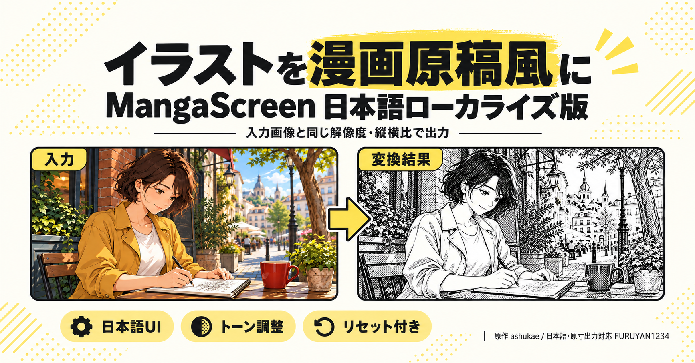
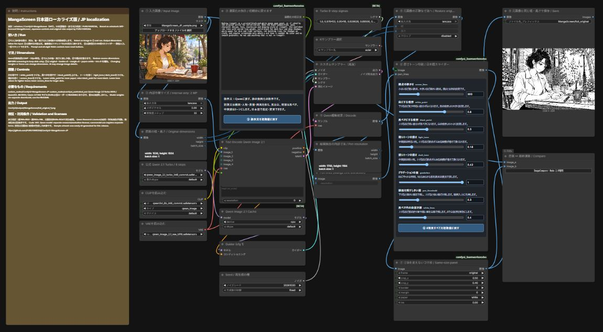

# MangaScreen JP — Japanese localization & original-size output / 日本語ローカライズ・原寸出力対応版

An unofficial derivative of [ashukae/ComfyUI-MangaScreen](https://github.com/ashukae/ComfyUI-MangaScreen), retaining the full Qwen-Image 2.1 Turbo 8-step workflow.
ashukae氏のMangaScreenを土台に、日本語操作と入力画像の原寸出力を追加した非公式派生版です。原作のフル構成を継承しています。

## Features / 特徴

- Keep the input width, height and aspect ratio, including odd sizes; internal Qwen editing uses about 2 MP, then returns to source dimensions **before** screening. / 入力の幅・高さ・縦横比を維持。内部2MP処理後、網点処理の前に原寸へ戻します。
- Japanese explanations, editable prompt with reset, eight synchronized sliders/numeric controls with reset. / 日本語説明、③の指示文リセット、⑥の8項目スライダー・数値入力と一括リセット。
- Unique JP node identifiers coexist with original nodes; zero-border all-black issue fixed. / 原版と共存できる専用識別子。枠幅0で全黒になる問題も修正。
- Actual output may change details because the full workflow uses an AI image edit. / 原寸追従は画素内容・構図の完全一致を保証するものではありません。

## Download / ダウンロード

[Release 20261020174738](https://github.com/FURUYAN1234/ComfyUI-MangaScreen-JP/releases/tag/20261020174738) · [ZIP](https://github.com/FURUYAN1234/ComfyUI-MangaScreen-JP/releases/download/20261020174738/MangaScreen_JP_OriginalSize_20261020174738.zip)

## Workflow and actual example / ワークフローと実作例

| Input / 入力 1536×1024 | Actual result / 実出力 1536×1024 |
|---|---|
|  |  |

The input artwork was newly AI-generated for this release; the result was produced by the included workflow. The thumbnail is promotional artwork; compare the full PNGs for real output.
入力は今回新規にAI生成した作例、結果は同梱ワークフローの実出力です。サムネイルは紹介用画像です。実際の画質は上記PNGで確認してください。

## Environment / 動作環境

Tested: ComfyUI 0.37.0, frontend 1.53.6, RTX 5080 16 GB, WSL Ubuntu. These are verified conditions, not minimum requirements.
確認環境は上記です。最小VRAMの保証ではありません。ComfyUI core must provide TextEncodeQwenImage21, QwenImage21Cache and ImageCompare. / これらの標準ノードがない場合はComfyUIを更新してください。

Install [comfyui_controlnet_aux](https://github.com/Fannovel16/comfyui_controlnet_aux) separately for Manga Lineart. Its detector weights download on first use.
線画抽出用の依存ノードを別途導入してください。初回は検出器の重みを取得するため通信が必要です。

## Install / インストール

Close/save the active workflow, extract the ZIP, then use the Python environment that runs ComfyUI.
編集内容を保存してZIPを展開し、ComfyUI用のPythonで実行します。

~~~sh
python verify_package.py .
python install.py --comfyui /absolute/path/to/ComfyUI --sample
python -m pip install -r requirements.txt
~~~

On Windows, pass your actual ComfyUI directory. Existing JP files are backed up under workflows/90_バックアップ/MangaScreen. Restart ComfyUI afterward.
Windowsでは実際のComfyUIルートを指定してください。既存ファイルはバックアップ後に配置します。導入後はComfyUIを再起動します。ブックマークはワークフロー一覧から手動で追加できます。

Download the three models separately into the following folders. Review model licenses first; weights are not included.
下記モデルは別途取得し、利用条件を確認してください。重みはZIPに含めていません。

| Folder / 配置先 | File / ファイル |
|---|---|
| models/diffusion_models | [qwen_image_2.1_turbo_int8_convrot.safetensors](https://huggingface.co/Comfy-Org/Qwen-Image-2.1/resolve/main/diffusion_models/qwen_image_2.1_turbo_int8_convrot.safetensors) |
| models/text_encoders | [qwen3vl_8b_int8_convrot.safetensors](https://huggingface.co/Comfy-Org/Qwen-Image-2.1/resolve/main/text_encoders/qwen3vl_8b_int8_convrot.safetensors) |
| models/vae | [qwen_image_2.1_vae_bf16.safetensors](https://huggingface.co/Comfy-Org/Qwen-Image-2.1/resolve/main/vae/qwen_image_2.1_vae_bf16.safetensors) |

## Normal use / 通常の使い方

1. Open workflows/01_静止画/02_画像_Qwen/01_通常版/20_画像編集/40_MangaScreen/MangaScreen_フル版_元画像サイズ.json in the workflow library. / ライブラリから同名のワークフローを開きます。
2. Choose an input image in ①, select installed model files in ②, and run. / ①に画像を読み込み、②のモデルを確認して実行します。
3. Adjust ③ prompt or ⑥ finish controls as needed. Reset buttons restore the supplied defaults. / 必要に応じて③と⑥を調整し、リセットで初期値に戻せます。
4. Keep ⑦ frame=original, border=0, margin=0, paper=white, ink=0 for exact dimensions and pure B&W. / 原寸・純白黒では⑦の初期値を維持してください。

| Control / 項目 | Default / 初期値 | Effect / 効果 |
|---|---:|---|
| screen_lines / 網点の細かさ | 200 | Lower = larger dots / 下げると粗い網点 |
| white_point / 白にする境界 | 0.8 | Lower = more white / 下げると白が増える |
| black_point / 黒ベタにする境界 | 0.3 | Higher = more black / 上げるとベタが増える |
| light_tone / 薄いトーン | 0.18 | Lower = lighter / 下げると薄くなる |
| dark_tone / 濃いトーン | 0.42 | Lower = lighter / 下げると薄くなる |
| gradation / グラデーション | 1.0 | 0 = flat tones / 0で平坦な段階トーン |
| pen_threshold / 線画しきい値 | 0.3 | Lower = more lines / 下げると細い線まで残す |
| white_lines / 白抜き線 | 0.4 | Higher = more white lines inside black / 上げるとベタ内の白線が増える |

## Output and checks / 出力と確認

PNG files are saved to ComfyUI/output/MangaScreen/full_original_*.png. Input/result dimensions should match. Margin or crop changes can alter them.
PNGの幅・高さを入力と照合してください。余白やコマ形状を変えると寸法が変わります。

Verified full runs: portrait 769×1153, landscape 1153×769 and the public example 1536×1024. Default output uses only pixel values 0 and 255.
縦・横・奇数寸法と公開作例で実生成を確認しました。枠幅0の修正は縦・横・正方形で回帰確認しています。

## Licenses / ライセンス

Original code: Copyright (c) 2026 ashukae, MIT. Modifications: FURUYAN1234, MIT. The full original license is preserved in [LICENSE](LICENSE); details in [NOTICE.md](NOTICE.md).
原作の著作権表示とMIT全文を保持しています。原作者の公式版と誤認させる表記はしていません。

**Qwen models have separate research/evaluation conditions; commercial use requires a separate license.** Code being MIT does not make the whole pipeline commercially unrestricted.
**Qwenモデルは研究・評価用途の別条件があり、商用利用は別許諾が必要です。** [Qwen license](https://huggingface.co/Qwen/Qwen-Image-2.1-Turbo/blob/main/LICENSE)。入力画像・他の重みの権利もそれぞれ確認してください。

## Related links / 関連リンク

[Original / 原作](https://github.com/ashukae/ComfyUI-MangaScreen) · [Original commit / 参照版](https://github.com/ashukae/ComfyUI-MangaScreen/tree/d0eb8dcc6c45274e3eee118ff0dabe05b56039b9) · [note article / 日本語記事](https://note.com/happy_duck780/n/n5c89a250fb82) · [Article source / 記事原稿](docs/note.md)

## Changelog / 変更履歴

- 20261020174738: Published note article, linked social copy, and redesigned the cover for note’s 1280:670 frame. / note公開、投稿文の誘導先修正、note比率に合わせた表紙と余白の修正。

- 20261020171819: Initial JP localization, original-size output, reset/slider UI, zero-border fix, release example and documentation. / 日本語操作・原寸出力対応の初回公開。
